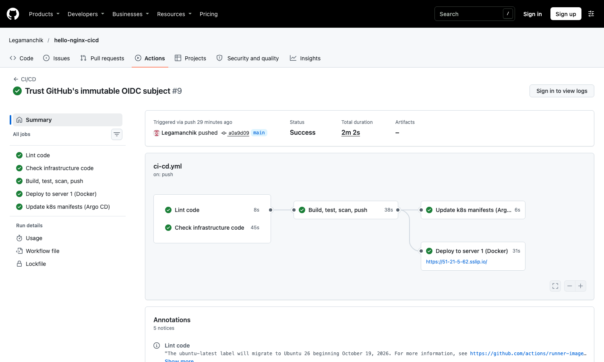
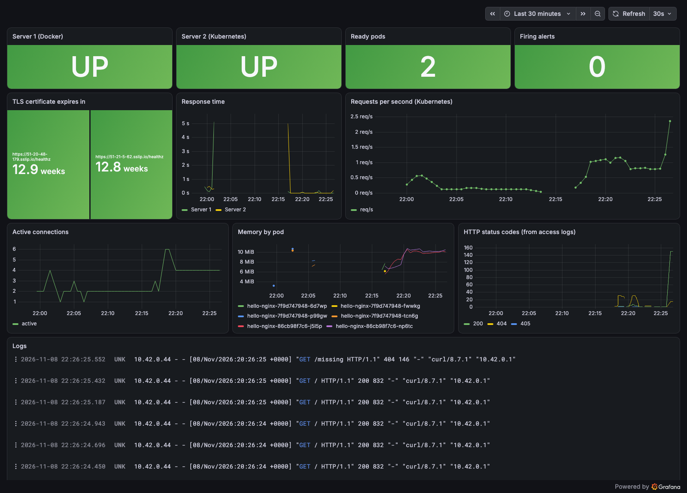
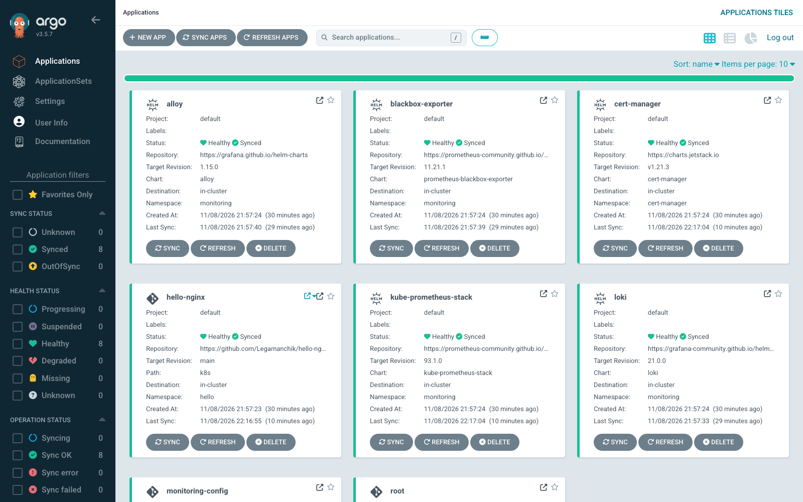
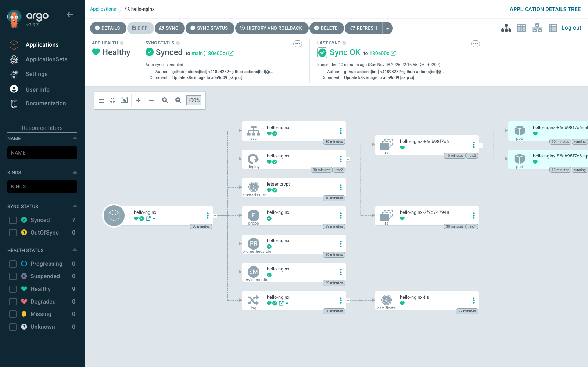
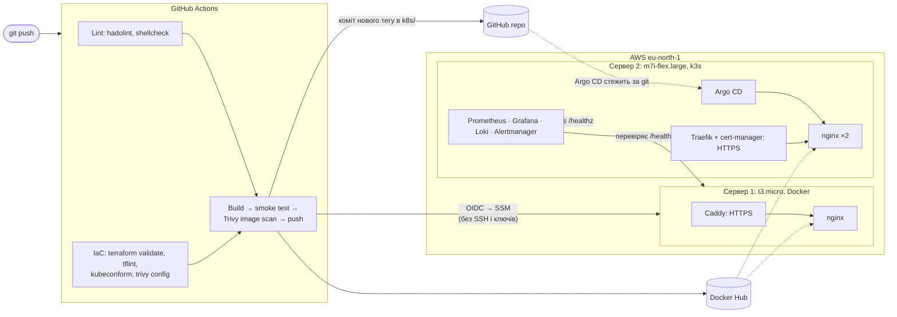

# Hello World на Nginx: Docker + CI/CD + Kubernetes

Сторінка «Hello, World!» на Nginx. Після кожного push у `main` вона сама збирається, проходить перевірки і викочується на два сервери в AWS. Уся інфраструктура описана в Terraform.

## Для перевіряльника

| Що | Посилання |
|---|---|
| Сайт, сервер 1 (Docker) | https://51-21-5-62.sslip.io |
| Сайт, сервер 2 (Kubernetes) | https://51-20-48-179.sslip.io |
| Pipeline | [GitHub Actions](https://github.com/Legamanchik/hello-nginx-cicd/actions/workflows/ci-cd.yml) |
| Яка версія зараз працює | `/version.txt` на будь-якому з сайтів повертає SHA коміту |

Grafana і Argo CD відкриті лише для IP адміністратора, тому нижче є їхні скріншоти.

### Як вимоги завдання закриті

| Вимога | Де |
|---|---|
| Dockerfile з веб-додатком на Nginx | [`Dockerfile`](Dockerfile), [`nginx/default.conf`](nginx/default.conf) |
| Скрипт: збірка → push у Docker Hub → деплой на сервер | [`scripts/deploy.sh`](scripts/deploy.sh) |
| CI/CD на кожну зміну, деплой на тестовий сервер | [`.github/workflows/ci-cd.yml`](.github/workflows/ci-cd.yml) |
| Сайт відкривається в браузері | посилання вище |
| Інструкція з налаштування | розділ [«Як розгорнути у себе»](#як-розгорнути-у-себе) |
| *Бонус:* моніторинг і логування | Prometheus, Grafana, Loki, алерти ([`argocd/apps/`](argocd/apps), [`k8s/monitoring.yaml`](k8s/monitoring.yaml)) |
| *Бонус:* Kubernetes | k3s + Argo CD ([`k8s/`](k8s), [`argocd/`](argocd)) |
| *Бонус:* Terraform | [`terraform/`](terraform) |

### Скріншоти

**Pipeline:** спершу перевірки коду й інфраструктури, потім збірка, а далі деплой паралельно на обидва сервери.


**Grafana, дашборд Hello Nginx:** стан обох сайтів, термін дії сертифікатів, час відповіді, запити, HTTP-статуси і логи.


**Argo CD:** усе в кластері розгорнуто з git і синхронізовано.



## Як це працює



**Сервер 1 (Docker)** оновлює `scripts/deploy.sh`. Новий контейнер запускається поруч зі старим, Caddy розподіляє трафік між ними, і старий видаляється лише тоді, коли новий пройшов healthcheck. Якщо новий не піднявся, старий просто продовжує працювати. Під час деплою з 224 запитів жоден не впав.

**Сервер 2 (Kubernetes)** працює за GitOps: CI лише комітить новий тег образу в `k8s/kustomization.yaml`, а Argo CD сам підтягує зміну і робить rolling update без простою. Доступу до кластера в CI немає взагалі.

### Чому так

| Рішення | Чому |
|---|---|
| Два сервери | Крок 2 завдання вимагає саме **скрипт** деплою, тому сервер 1 оновлюється через `deploy.sh`. Kubernetes + GitOps — це бонус, і він тягне pull-модель, у якій скрипт не потрібен. |
| GitHub Actions + Docker Hub | Безкоштовні для публічного репозиторію, і Docker Hub названо в самому завданні. |
| Деплой через OIDC + SSM, а не SSH | У GitHub немає ні AWS-ключів, ні SSH-ключа. Роль в AWS видає короткоживучу сесію лише job-у `deploy` з цього репозиторію, а порт 22 закритий для всіх, крім адміністратора. |
| Trivy блокує збірку | Вразливий образ не потрапить на сервер. Так уже сталося при першому запуску: базовий образ мав вразливості, тому в Dockerfile додано `apk upgrade`. |
| Тег образу = SHA коміту | Завжди видно, який саме коміт працює, і відкотитися можна точно на потрібну версію. |
| `nginx-unprivileged`, read-only FS, `cap-drop ALL` | Навіть якщо контейнер зламають, root і запис у файлову систему недоступні. |
| sslip.io | Безкоштовний домен, який вказує на IP. Він потрібен, щоб Let's Encrypt видав справжній сертифікат. |
| k3s на одному сервері | Повноцінний Kubernetes за ціною одного EC2. EKS коштує від $73 на місяць лише за control plane. |
| Стан Terraform у S3 з `use_lockfile` | Не загубиться разом з ноутбуком і не зламається від двох одночасних `apply`. |

## Що де лежить

| Шлях | Що там |
|---|---|
| `app/`, `nginx/`, `Dockerfile` | сайт, конфіг Nginx (`/healthz`, `/nginx_status`, security-заголовки) і образ |
| `scripts/deploy.sh` | збірка, push і деплой на сервер 1 (через SSM або SSH) |
| `.github/workflows/ci-cd.yml` | pipeline |
| `.github/dependabot.yml` | щотижневе оновлення actions, базового образу і провайдерів Terraform |
| `k8s/` | сайт у Kubernetes: Deployment, Service, Ingress з TLS, метрики, алерти, перевірки доступності |
| `argocd/root.yaml` | головний застосунок Argo CD, який підтягує все з `argocd/apps/` |
| `argocd/apps/` | що встановлено в кластері: сайт, Prometheus + Grafana, Loki, Alloy, blackbox exporter, cert-manager |
| `monitoring/` | дашборд Grafana (генерується скриптом `build.py`) |
| `terraform/` | EC2, security groups, Elastic IP, IAM для OIDC/SSM |
| `terraform/state-bucket/` | S3-бакет для стану Terraform (створюється один раз) |

## Як розгорнути у себе

Знадобляться акаунти **AWS**, **GitHub** і **Docker Hub**. Локально треба встановити `terraform` ≥ 1.10, `aws` CLI, `gh` і `jq`.

**1. Увійти в AWS і GitHub**
```bash
aws login
```
```bash
gh auth login
```

**2. Створити бакет для стану Terraform** (один раз)
```bash
cd terraform/state-bucket && terraform init && terraform apply
```
Потім скопіюйте `terraform/backend.hcl.example` у `terraform/backend.hcl` і впишіть туди назву бакета з виводу команди.

**3. Підняти сервери**

Створіть SSH-ключ. Він потрібен лише адміністратору, CI ним не користується:
```bash
ssh-keygen -t ed25519 -N "" -f ~/.ssh/hello-nginx-deploy
```

Створіть `terraform/terraform.tfvars`. Цей файл у git не потрапляє:
```hcl
admin_cidrs                = ["ВАШ_IP/32"]   # curl https://checkip.amazonaws.com
admin_password             = "придумайте-пароль"  # для Argo CD і Grafana
github_oidc_subject_prefix = "..."  # gh api repos/OWNER/REPO/actions/oidc/customization/sub --jq .sub_claim_prefix
```

Запустіть:
```bash
cd terraform && terraform init -backend-config=backend.hcl && terraform apply
```
Terraform виведе IP серверів, ID інстансу, ARN ролі для GitHub і всі посилання. Сервер 2 налаштовується ще ≈ 5 хвилин: встановлюються k3s і Argo CD, а Argo CD сам розгортає з git сайт і моніторинг.

**4. Налаштувати GitHub**

Значення візьміть з виводу `terraform output`:
```bash
gh variable set DOCKERHUB_USERNAME  --body <логін_docker_hub>
gh variable set AWS_REGION          --body eu-north-1
gh variable set AWS_DEPLOY_ROLE_ARN --body <github_deploy_role_arn>
gh variable set DEPLOY_INSTANCE_ID  --body <app_instance_id>
gh variable set DEPLOY_HOST         --body <public_ip>
gh variable set SITE_DOMAIN         --body <public_ip_через_дефіси>.sslip.io
gh secret set DOCKERHUB_TOKEN
```
Остання команда попросить вставити токен Docker Hub (*Account settings → Personal access tokens*, права Read & Write). Це **єдиний секрет** у репозиторії.

Якщо ви зробили fork, замініть адресу репозиторію (`repoURL`) в `argocd/` і IP-адреси в `k8s/ingress.yaml`, `k8s/monitoring.yaml` та `monitoring/dashboards/build.py`.

**5. Запушити код.** Через ~2 хвилини сайт доступний на обох серверах.

## Перевірка

| Що | Де |
|---|---|
| Сайти | `https://<IP-через-дефіси>.sslip.io` для обох серверів (по IP теж працює, але без HTTPS) |
| Стан і версія | `/healthz` повертає `ok`, а `/version.txt` повертає SHA коміту |
| Argo CD | `https://<IP_сервера_2>:30443`, логін `admin` (сертифікат самопідписаний) |
| Grafana | `http://<IP_сервера_2>:30300` → *Dashboards → Hello Nginx* |

Щоб перевірити автодеплой, змініть текст в `app/index.html` і запуште.

## Моніторинг і алерти

- **Метрики:** Prometheus збирає метрики сервера, Kubernetes і nginx (через sidecar `nginx-prometheus-exporter`).
- **Доступність:** blackbox exporter кожні 30 секунд відкриває `https://…/healthz` на обох серверах. Заодно він стежить за терміном дії сертифікатів.
- **Логи:** Alloy збирає логи всіх подів, а Loki зберігає їх 3 дні. На дашборді є розподіл HTTP-статусів і самі логи.

| Алерт | Коли спрацьовує |
|---|---|
| `HelloNginxSiteDown` | сайт не відповідає 2 хвилини |
| `HelloNginxNoReadyPods` | у Kubernetes немає жодного робочого пода |
| `HelloNginxRestarting` | контейнер перезапустився більше 3 разів за 15 хвилин |
| `HelloNginxSlow` | сайт відповідає довше 1 секунди протягом 5 хвилин |
| `HelloNginxCertExpiresSoon` | сертифікат спливає менше ніж за 14 днів |

Ці алерти видно на дашборді (панель *Firing alerts*) і в *Grafana → Alerting*. Логи сервера 1 зберігаються на самому сервері з ротацією і переглядаються командою `docker logs`.

## Корисні команди

```bash
./scripts/deploy.sh all                       # ручний деплой (потрібні IMAGE_NAME, DEPLOY_HOST, DEPLOY_INSTANCE_ID)
DEPLOY_METHOD=ssh ./scripts/deploy.sh deploy  # те саме через SSH (з IP адміністратора)
docker build -t hello . && docker run -p 8080:8080 hello   # запуск локально → http://localhost:8080
ssh ec2-user@<IP_сервера_2> 'kubectl -n argocd get applications'   # що розгорнув Argo CD
python3 monitoring/dashboards/build.py        # перегенерувати дашборд
```

## Вартість і видалення

| | За добу |
|---|---|
| Сервер 1 (`t3.micro`) | ≈ $0.26 |
| Сервер 2 (`m7i-flex.large`, 8 GB під моніторинг) | ≈ $2.90 |
| 2 статичні IP, диски, S3 | ≈ $0.35 |

Разом ≈ $3.5 на добу. Без моніторингу сервер 2 можна зменшити до `k8s_instance_type = "t3.small"` (≈ $0.50 на добу).

Видалити все:
```bash
cd terraform && terraform destroy
```

## Якщо щось не працює

- **Деплой падає на `configure-aws-credentials`:** `github_oidc_subject_prefix` не збігається з репозиторієм. Перевірте значення командою з кроку 3.
- **Деплой падає з `Remote deploy finished with status: Failed`:** у лозі видно `docker logs` нового контейнера. Стара версія при цьому продовжує працювати.
- **Trivy зупинив збірку:** у базовому образі з'явилися нові вразливості. Зазвичай допомагає просто перезапустити pipeline.
- **Сервер 2 не відповідає:** подивіться лог встановлення:
  ```bash
  ssh ... 'sudo cat /var/log/bootstrap-k3s.log'
  ```
- **У Grafana немає даних одразу після створення сервера:** зачекайте 2–3 хвилини, поки Argo CD розгорне моніторинг.
